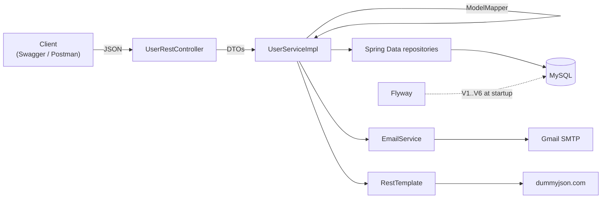
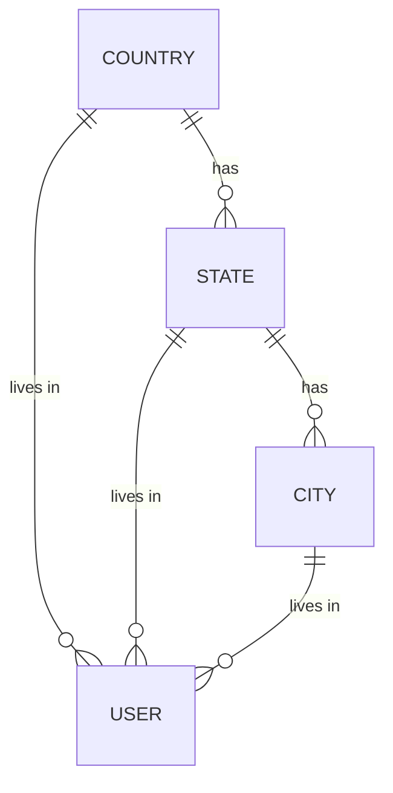
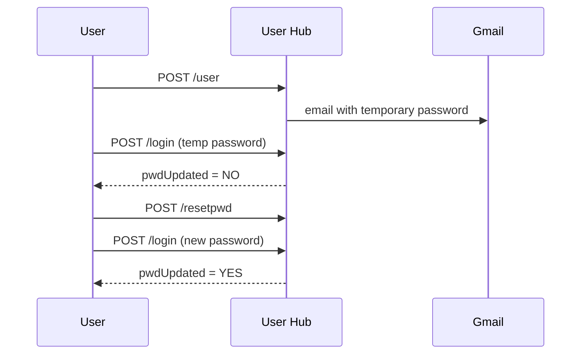
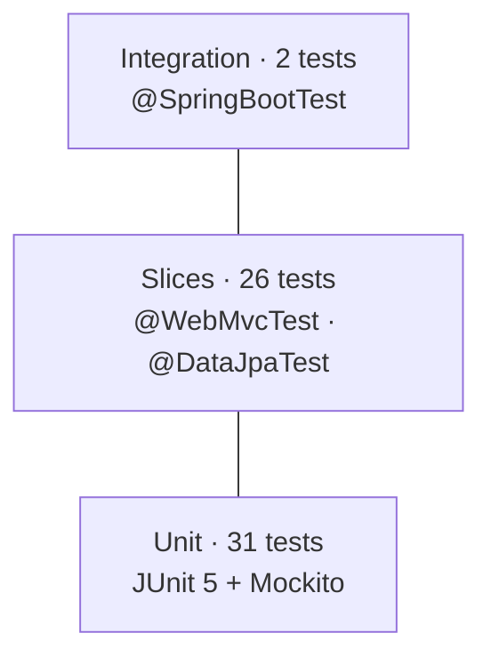

# User Hub

REST API for **user registration with a cascading Country → State → City picker**, temporary-password email,
login, and forced password reset. Built with Spring Boot 4, MySQL and Flyway, documented with Swagger,
and covered by 59 automated tests.

---

## Features

- **Location dropdowns** — countries, states of a country, cities of a state (India: 36 states/UTs, USA: 50 states, sample cities)
- **Email availability check** before registration
- **Registration** — generates a temporary password and emails it (Gmail SMTP)
- **Login** — returns the user profile; `pwdUpdated: "NO"` tells the UI to force a password reset
- **Reset password** — verifies the old password and the confirmation before updating
- **Quote of the day** — proxied from an external API (dummyjson.com)
- **Swagger UI** for trying every endpoint in the browser

---

## Tech stack

| Area | Technology |
|---|---|
| Language / framework | Java 17, Spring Boot 4.0.7 (Spring Framework 7, Jackson 3) |
| Web | Spring Web MVC (`spring-boot-starter-webmvc`) |
| Persistence | Spring Data JPA, Hibernate, MySQL 8 |
| Schema migrations | Flyway (`spring-boot-starter-flyway`, `flyway-mysql`) |
| Mapping | ModelMapper 3.2.0 |
| Mail | Spring Mail (Gmail SMTP) |
| API docs | springdoc-openapi 3.1.1 (Swagger UI) |
| Boilerplate | Lombok |
| Testing | JUnit 5, Mockito, AssertJ, MockMvc, `@WebMvcTest`, `@DataJpaTest`, `@SpringBootTest` |

---

## Architecture



- Controllers only handle HTTP; entities never leave the service layer (DTOs in, DTOs out).
- Flyway owns the schema; Hibernate runs with `ddl-auto=validate`.

### Data model



---

## API

All endpoints return the same envelope: `{ "status": 200, "message": "…", "data": … }`

| Method | Path | Body | Description |
|---|---|---|---|
| GET | `/countries` | — | All countries |
| GET | `/states/{countryId}` | — | States of a country |
| GET | `/cities/{stateId}` | — | Cities of a state |
| GET | `/unique/{email}` | — | `"UNIQUE"` or `"DUPLICATE"` |
| POST | `/user` | `{name, email, phno, countryId, stateId, cityId}` | Register + email temp password |
| POST | `/login` | `{email, pwd}` | Login; response contains `pwdUpdated` (password is never returned) |
| POST | `/resetpwd` | `{email, oldPwd, newPwd, confirmPwd}` | Change the password |
| GET | `/quote` | — | Random quote |

### User journey



---

## Getting started

### Prerequisites
- JDK 17+
- MySQL 8 running on `localhost:3306`
- A Gmail account with **2-Step Verification** and an **App Password**

### 1. Create the databases
```sql
CREATE DATABASE userhub_schema;   -- application
CREATE DATABASE userhub_test;     -- automated tests
```
Tables and seed data are created automatically by Flyway on first start.

### 2. Set mail credentials (environment variables)
```bash
# Git Bash / Linux / macOS
export MAIL_USERNAME=your.name@gmail.com
export MAIL_PASSWORD=your16charapppassword
```
On Windows you can add them under *Edit environment variables for your account*.
The database user/password are configured in `src/main/resources/application.properties` (default `root` / `root`).

### 3. Run
```bash
./mvnw spring-boot:run
```

### 4. Try it
- Swagger UI: http://localhost:8080/swagger-ui.html
- OpenAPI JSON: http://localhost:8080/v3/api-docs

---

## Database migrations (Flyway)

Located in `src/main/resources/db/migration`:

| Version | Purpose |
|---|---|
| V1 | Create `country`, `state`, `city`, `user` tables + foreign keys |
| V2 | Seed countries (India, USA) |
| V3 | Seed 36 Indian states / union territories |
| V4 | Seed 50 US states |
| V5 | Seed sample cities |
| V6 | `user.phone_number` INT → BIGINT (10-digit numbers) |

Rule: never edit an applied script — add a new `V<n>__description.sql` instead.

---

## Testing

```bash
./mvnw test                                   # all tests
./mvnw test -Dtest=UserServiceImplTest        # one class
```
Tests use the `test` profile (`src/test/resources/application-test.properties`):
database `userhub_test`, dummy mail settings — real data and real mail are never touched.



| Test class | Type | Tests | What it covers |
|---|---|---|---|
| `UserServiceImplTest` | Unit (Mockito) | 27 | Lookups, register, login, reset password, quote (`mockConstruction` for `RestTemplate`) |
| `EmailServiceTest` | Unit (Mockito) | 4 | Mail content, SMTP failure handling |
| `UserRestControllerTest` | `@WebMvcTest` + MockMvc | 16 | URLs, status codes, JSON shape, `@RequestBody` binding, password hidden, malformed JSON → 400 |
| `RepositoryTest` | `@DataJpaTest` (real MySQL) | 10 | Flyway seed data, derived queries, timestamps, BIGINT round-trip |
| `UserHubApplicationTests` | `@SpringBootTest` | 1 | Application context starts, Flyway + schema validation |
| `UserFlowIntegrationTest` | `@SpringBootTest` + MockMvc | 1 | Full journey: register → read mail → login → reset → login |
| **Total** | | **59** | |

Each test carries an ID in its `@DisplayName` (e.g. `TC-S12`, `TC-C11`, `TC-R09`).

---

## Project structure

```
src/main/java/com/spring
├── UserHubApplication.java      # entry point + ModelMapper bean
├── config/OpenApiConfig.java    # Swagger metadata
├── rest/                        # REST controllers
├── service/                     # business logic, EmailService
├── repo/                        # Spring Data JPA repositories
├── entities/                    # JPA entities
└── dto/                         # request/response DTOs, ApiResponse<T>
src/main/resources
├── application.properties
└── db/migration/                # Flyway scripts
src/test/java/com/spring
├── UserHubApplicationTests.java # context loads
├── service/                     # unit tests (Mockito)
├── rest/                        # @WebMvcTest controller tests
├── repo/                        # @DataJpaTest repository tests
└── integration/                 # @SpringBootTest end-to-end flow
src/test/resources/application-test.properties
```

---

## Roadmap

- Proper HTTP status codes (201 / 401 / 404 / 409) and a global `@RestControllerAdvice`
- Bean Validation (`@Valid`, `@Email`, `@NotBlank`)
- Password hashing with BCrypt; `SecureRandom` temporary passwords
- Unique constraint on `user.email` (Flyway V7)
- `@Transactional` registration; injected `RestClient` for the quote API
- Externalised database credentials

---

## Author

**Deeps B** — [github.com/dpkb-dev](https://github.com/dpkb-dev)
